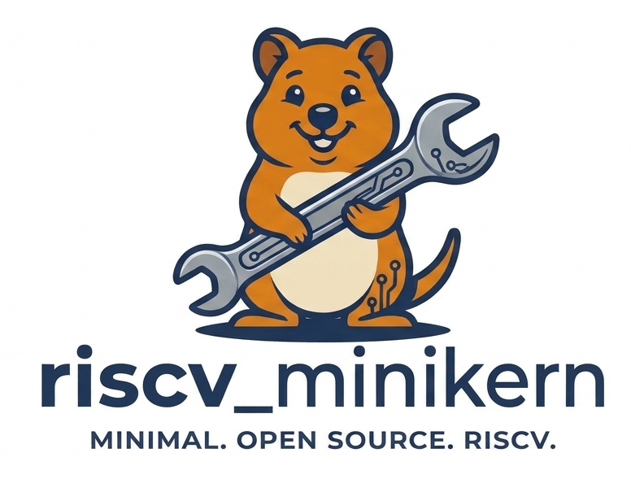

# minikern (RISC-V)



A from-scratch kernel for the **StarFive JH7110** — the SiFive VisionFive 2 —
that copies no Linux code but implements Linux's syscall interface, so that
ordinary `GOOS=linux GOARCH=riscv64` Go binaries run on it unchanged.

MIT licensed. Built and tested entirely with Bazel.

## Status

A stock **gc Go binary** for `linux/riscv64` — built by the ordinary Go
toolchain, with no build tags and no knowledge of this kernel — is read off
an XFS filesystem and runs unchanged: goroutines on real threads, a contended
mutex, channels, the garbage collector, sleeps that really sleep, panic and
recover. That was the goal of the ARM project this migrated from, and it is
now reached on RISC-V.

**On real hardware.** A StarFive VisionFive 2 boots this kernel, brings up
its SD card and an NVMe drive in its M.2 slot, reads the GPT on the drive,
mounts XFS, loads that Go binary off the card and runs it on all four U74
cores — 3.3x on eight units of work. `FEATURES.md` lists what the board
proved and what each of those things cost, and `ROADMAP.md` lists what is
missing, because an emulator had agreed
with every mistake they found: a response with no CRC whose CRC was being
checked, a configuration read to an unrouted bus that never returns, a
filesystem whose reader and writer disagreed about where its log was, and a
`running++` across four real cores that quietly cost the machine half its
CPUs.

## This is a migration, not a fresh start

It is the continuation of
[**arm_minikern**](https://github.com/mateuszmierzwinski/arm_minikern), which
reached a working kernel on an Allwinner H3: Go on four cores, its own EMAC
driver and IPv4/TCP stack, its own authenticated netboot protocol, XFS over a
network block device, `fork`/`exec`, and the real SD-card boot chain through
U-Boot. That repository stays as the record of it.

The move is away from **32-bit ARM**, and the reason is that the remaining
friction there was the architecture rather than the design. What that kernel
had to carry:

| On 32-bit ARM | On RISC-V |
|---|---|
| `mmap2` taking page offsets, `_llseek`, `fcntl64`, a 104-byte `stat64`, `futex_time64` — the whole 32-bit legacy ABI | the generic syscall table: `mmap`, `lseek`, `fcntl`, `stat`, `futex`, each once |
| the ARM-private `set_tls` syscall, and `HWCAP_TLS` to advertise it | the thread pointer is a register (`tp`) the ABI already defines |
| a HYP→SVC mode drop on every core, or its MMU writes land on the hypervisor's registers | the firmware leaves the kernel in S-mode and there is nothing to negotiate |
| banked registers per mode, eight exception vectors | one `stvec`, one `scause`, one `sepc` |
| PSCI, which started secondaries in the wrong mode and then *refused* to power the machine off | SBI, specified and implemented by firmware on every machine, including the emulator |
| two boot protocols to tell apart (ATAGs and a device tree) | a device tree, always, in `a1` |
| `uint32_t` physical addresses — correct on a 512 MiB board, wrong on an 8 GiB one | 64-bit throughout |
| soft-float kernel builds, so no FPU state is touched before it is enabled | `sstatus.FS` gates the FPU in hardware |
| 64-bit division helpers, written by hand (`__aeabi_uldivmod`) | the ISA divides 64-bit natively |

What carries over untouched is the part that took the longest: **`src/core/`
includes nothing from `arch/` or `board/`** — the network stack, TCP, XFS, NBD,
the allocators, the ELF loader, the device-tree reader — and its host tests run
on day one of this port rather than at the end of it.

## State

Early. The kernel boots on QEMU's `virt` machine under real OpenSBI firmware,
in S-mode, reads its device tree, and powers the machine off through SBI. Four
host tests and one boot test, all green. `DEVELOPMENT_PROGRESS.md` is the plan and the record, `GOALS.md` the design and the measured hardware facts.

```bash
bazel test //...          # host tests
bazel test //:qemu_tests   # under the emulator
```

## Why the VisionFive 2 is a better target than the board before it

The ARM project ended one item short, and that item could never be closed: the
Allwinner H3's PHY-select register, its thermal sensor and its pin controller
are not modelled by any emulator, so three registers had to be taken on faith
until the hardware was in hand.

QEMU's `virt` machine models everything this kernel needs — SBI, the PLIC, the
CLINT, virtio — so the bring-up is verifiable without a board at all. The
JH7110's own peripherals still need the board, but it is a better-documented
part: upstream Linux support, a published technical reference manual, and
standard IP blocks (a DesignWare GMAC, a Cadence SD host controller, a generic
NVMe-over-PCIe root port) with independent implementations to check against.

## The toolchain is clang

There is no riscv64 cross-gcc installable without root on the development
machine, and clang is a cross compiler by construction. It produces the
freestanding RV64 image with `ld.lld`, and nothing else is needed: SBI loads
the kernel's **ELF** directly, so neither `objcopy` nor `mkimage` appears in
this build — two host-tool dependencies the ARM project had and this one does
not.
